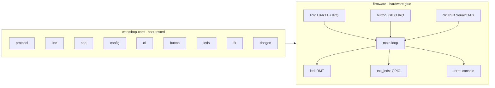
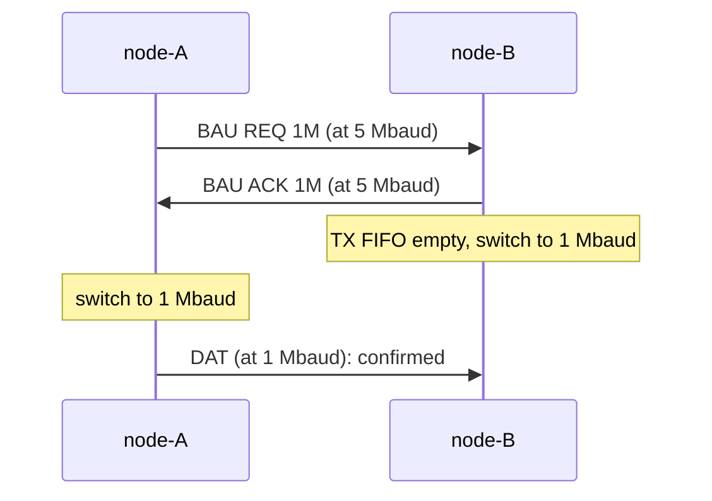

# Architecture

## Two crates

| Crate | Contents | Tested |
|---|---|---|
| `firmware/shared/core` | everything that doesn't touch a peripheral: frame protocol, line splitting, lost-frame detection, configuration and its validation, CLI editor/parser/help table, button debouncing, LED logic, RGB color math, documentation generator | on the host (`cargo test-host`): unit tests, property tests, doc examples |
| `esp32-rust-workshop` (root) | the hardware glue: UART1 + interrupt, GPIO + interrupt, RMT (RGB LED), USB Serial/JTAG (CLI), TRNG, console output, main loop | on the board (`cargo test-target`) |

The firmware re-exports the core modules (`crate::config`, `crate::protocol`...),
so the node configs and the rest of the code don't need to know about the split.

## The main loop

The firmware is a single loop, with two interrupts feeding it:

1. render the RGB LED frame when due, update the breadboard LEDs;
2. read CLI key presses, apply complete commands;
3. turn a debounced button edge into an `EVT` frame;
4. send the periodic `DAT` frame;
5. read bytes buffered by the UART interrupt, split them into lines, decode frames;
6. print the stats line when due.

## Receiving at 5 Mbaud

At 5 Mbaud the 128-byte UART RX FIFO fills in about 256 µs, faster than the loop
can be relied on to poll it: printing a line to the USB console can take longer.
So:

- an interrupt (FIFO half full, or line idle for 10 symbols) drains the FIFO into
  a 2 KB ring buffer, and the loop reads from it;
- `esp-println` is used **without** its `critical-section` feature, which would mask
  interrupts during every print;
- nothing is printed inside a critical section.

`verbose wire` shows the ring buffer peak (`RX buffer peak 33/2048`).

## Timing on the wire

Each `DAT` line shows `Δ`, the time since the previous `DAT` frame **in either
direction**, and `rtt` values are computed the same way. Both use one reference:
the moment the frame's `\n` finished on the wire, not when the main loop got to
it (printing to the USB console can delay that by milliseconds).

- **Received**: the UART interrupt notes when it read each `\n`, then corrects it:
  minus one byte time (2 µs at 5 Mbaud) per byte that came after it in the same
  batch, and minus the idle timeout when the interrupt fired because the line went
  quiet. What remains is the interrupt latency, a few µs.
- **Sent**: the time the frame was queued in the (empty) TX FIFO, plus its duration
  on the wire (`length × 10 bits / baud rate`).

Measured on the boards: received deltas vary by about ±0.15 ms, sent ones by about
±0.8 ms (a DAT goes out when the main loop checks its timer). The link is
full-duplex, so a delta can be slightly negative: a received frame can end while
one of ours is being sent. The math is in `workshop_core::wire`, tested on the host.

## Button debouncing

Two buttons, the jumper (`pins.button`) and BOOT (GPIO61), share esp-hal's single
GPIO interrupt handler: it checks each pin's interrupt flag and only records that
its line moved, and when. The loop then asks one
`workshop_core::button::Debouncer` per button:

- **debounce** (30 ms): the line must be quiet that long before its level is read;
- **lockout** (150 ms): after an accepted edge, further changes are ignored. A
  jumper sliding into a breadboard can lose contact for longer than the debounce
  time; the level is read again when the lockout ends, so a real change is never
  missed.

## Random keys

`EVT` keys come from the ESP32-S31 true random number generator. esp-hal 1.2.2
reads it from the right register on this chip but never starts it, and the
ESP-IDF bootloader turns it off before jumping to the app: every key would be the
same. `firmware/uart/src/trng.rs` starts it at boot, like `trng_ll_enable()` in ESP-IDF v6.1.

## Link tests

Three features exercise the link; their logic is in `workshop-core` (`baud`,
`rtt`, `burst`), tested on the host.

**Speed change (`baud`).** Both nodes must use the same baud rate, so a change is a
handshake of `BAU` frames: the requester sends `REQ` at the current speed, the
peer answers `ACK`, waits until it has left its UART, and switches; the requester
switches on the `ACK`. The first valid frame at the new speed confirms the switch.
If none arrives in time, each node goes back to the boot speed on its own: both
know it, so they meet again there.

**Round-trip time (`tx on-rx`).** A node in `on-rx` mode stops sending `DAT` and
answers each frame from the peer with an `ECH` carrying that frame's `seq`. The
peer remembers when it sent its last 16 frames, and shows the difference: both
UART transfers plus the reaction time of the other node's main loop.

**Bursts (`burst`).** `BST` frames are scheduled by `BurstTx` (frame *i* is due at
*start + i / rate*, so a late loop catches up without drifting; back-to-back
bursts send for at most 2 ms per loop iteration so the rest keeps running). The
receiver counts them with `BurstRx` instead of printing them (the USB console
couldn't keep up), and prints one summary: received, lost, corrupted, throughput
and share of the line capacity (8N1: 10 bits per byte).

## Configuration

`NodeConfig` holds everything a node may choose on its own. It is validated by a
`const fn`, so an invalid value fails the build; the CLI `set` command and the
settings saved in flash (`save`) go through the same function at runtime. Cargo
features (`persist`, `watchdog`, `rtt`) choose what is compiled in. The whole map
is on the [Configuration](configuration.md) page; every key is in the
[settings reference](reference/config.md).
