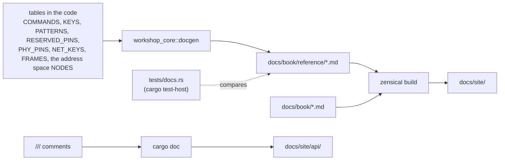

# Formatting, generated docs and recordings

Three routines keep the project tidy: **formatting** (one command),
**documentation generated from the code** (so it can't drift from it, checked by
CI) and **console recordings** (GIFs you can restyle without a board).

## Formatting

```sh
python3 scripts/dev.py format            # format everything
python3 scripts/dev.py format --check    # only check, change nothing
```

CI checks the formatting (`cargo fmt --all -- --check`, plus `cargo fmt -- --check` in `firmware/ethernet`, which is
its own Cargo workspace: job **format**): an unformatted push fails. Run `python3 scripts/dev.py format` before
committing; it formats both workspaces.

| Language | Tool | Scope | Settings |
|---|---|---|---|
| Rust | `cargo fmt --all` (rustfmt), and `cargo fmt` in `firmware/ethernet` | both workspaces: the firmwares, `workshop-core`, `workshop-presets`, tests | `rustfmt.toml`: 120 columns, `use_small_heuristics = "Max"` |
| Python | `black --line-length 100` | `scripts/` | line length 100 |

On top of formatting, **clippy** runs with `-D warnings` (any warning fails), and
the workspace sets a few lints in `Cargo.toml`:

| Lint | Level | Why |
|---|---|---|
| `rustdoc::broken_intra_doc_links` | deny | a link like [`NodeConfig`] to something that doesn't exist fails the docs build |
| `missing_docs` (in `workshop-core`) | warn | every public item of the core is documented |
| `clippy::mem_forget` (firmware binaries) | deny | esp-hal drivers rely on `Drop` to leave the hardware in a sane state |

## Documentation generated from the code

The site has three kinds of pages:

| Kind | Where | Written by | Kept up to date by |
|---|---|---|---|
| Guides | `docs/book/*.md` | hand | review |
| Reference | `docs/book/reference/*.md` | `workshop_core::docgen` | a test that fails when they're stale |
| API | `docs/site/api/` (not committed) | `cargo doc` from the `///` comments | rebuilt by CI on every push |



### The reference pages

The firmware already holds the facts the reference pages describe: the CLI help
table, the settings and their ranges, the frame formats, the reserved pins, the
color patterns. `workshop_core::docgen` turns them into Markdown:

| Page | Generated from |
|---|---|
| `reference/cli.md`, `eth-cli.md` | `cli::COMMANDS`: usage, aliases, summary, details, examples (the same table as the `help` command), for the commands of the UART app / of the Ethernet app |
| `reference/config.md`, `eth-config.md` | `config::KEYS` and `Key::describe()`: meaning, accepted values, defaults from `NodeConfig::DEFAULT` / `DEFAULT_NET`; the Ethernet page adds the `[net]` settings (`net::NET_KEYS`) |
| `reference/protocol.md`, `eth-protocol.md` | frame formats, field descriptions, and examples taken from `test_vectors::FRAMES` (checksums verified by the tests) |
| `reference/space.md` | the address space (UA-lite): its frames, status codes and every node, from `space::NODES` and the settings |
| `reference/pins.md`, `eth-pins.md` | default pins, `RESERVED_PINS` (with the reason for each) and `MISSING_PINS`; the Ethernet page adds the PHY's GPIO5-19 (`net::PHY_PINS`) |
| `reference/patterns.md` | `fx::PATTERNS`: names, descriptions, color swatches |

Each page starts with a comment saying it's generated. **Don't edit them by
hand**: change the code, then regenerate.

### The freshness check

`firmware/shared/core/tests/docs.rs` regenerates every page in memory and compares
it with the committed file. It runs with the host tests, so in CI too: adding a
command, a setting or a pin rule without updating the docs **fails the build**.

```sh
UPDATE_DOCS=1 cargo test-host               # rewrite the pages from the code
python3 scripts/dev.py test host -u         # same thing
git add docs/book/reference                 # and commit them with the code change
```

### Examples that are tests

Code blocks in `///` comments are compiled and run by `cargo test-host` (18 of
them). An example that no longer matches the API fails the tests instead of
misleading a reader.

### The site

[Zensical](https://zensical.org) builds `docs/book/` into `docs/site/`, with the
settings of `docs/zensical.toml` and the theme overrides of `docs/templates/`.

```sh
python3 scripts/dev.py docs serve --open    # http://localhost:3000, rebuilt on each change
python3 scripts/dev.py docs build -r        # regenerate the reference pages, then build
python3 scripts/dev.py docs api --open      # rustdoc of the core and the firmware
```

## Console recordings (the GIFs)

The animated terminals of the README and of [the console tour](console.md) are **recordings of real sessions**. A
recording is an asciicast (`.cast`): the raw text the console printed, with its timing and colors. A GIF is then
rendered from it by [agg](https://github.com/asciinema/agg) and shrunk by gifsicle (`brew install agg gifsicle`).
Because the cast keeps the text, **a GIF can be restyled without recording again, and without a board**.

| Script | What it does | Needs the boards |
|---|---|---|
| `scripts/record.py` | records one session of a command in a pseudo-terminal (it types `--type 7:"help"` like a person would), writes the cast, renders the GIF | yes |
| `scripts/record_demos.py` | the Ethernet scenes of the README (`boot`, `cli`, `burst`, `tcp`): flashes both boards with the right preset, records node A | yes |
| `scripts/render_demos.py` | renders existing casts to GIFs again, with another look | **no** |

The look is in one documented file, `docs/book/assets/demo/render.toml`, read by all three:

| Key | Meaning | Default |
|---|---|---|
| `font_size` | text size in whole pixels. The GIF is `cols x` one character wide, so a smaller font makes a smaller picture and file | 15 |
| `line_height` | line spacing, times the font size | 1.3 |
| `theme` | `monokai`, `dracula`, `nord`, `github-dark`, `github-light`, `solarized-dark`... | monokai |
| `font_family` | a monospace font, or a list tried in order (empty: JetBrains Mono, Fira Code, SF Mono, Menlo...) | empty |
| `speed` | playback speed, 2 = twice as fast | 1.0 |
| `idle_time_limit`, `last_frame_duration` | longest pause kept, and how long the last frame stays, seconds | 1.2, 3 |
| `fps_cap` | frames per second at most (lower is a smaller file) | 30 |
| `cols`, `rows` | size of the terminal window, in characters (0 = as recorded) | 0 |
| `colors` | palette size, 2-256 (256 is lossless) | 256 |

```sh
python3 scripts/render_demos.py --list              # the look each cast gets
python3 scripts/render_demos.py --font-size 12      # everything smaller (one run, nothing edited)
python3 scripts/render_demos.py eth-boot --speed 2  # one cast, twice as fast
python3 scripts/record.py x.cast --render-only --theme nord    # the same, for one file
python3 scripts/record_demos.py burst --font-size 12           # record a scene in another look
```

To keep a value, write it in `render.toml`: in `[style]` for every recording, or in a table named like the cast
(`[eth-boot]`, with any of the keys above) for one. Every key is checked, and a wrong one stops with a message that
says which. The casts of the UART app (`boot`, `cli`, `link`, `rtt`) were recorded before the live console line and
the new status line; `record.py` records them again with the commands of [the console tour](console.md#recording-a-session).

## In CI, on every push

`.github/workflows/ci.yml`:

1. **format**: `cargo fmt --all -- --check`, and the same in `firmware/ethernet`;
2. **host-tests**: `cargo test-host` (including the freshness check and the presets), every
   example of `firmware/shared/core/examples/` (the code shown on the
   [Examples](examples.md) page), clippy on the core and the presets tool, and `cargo presets check`;
3. **firmware-eth**: the Ethernet app, built (with the UDP presets, then the TCP ones) and linted with
   `-D warnings` for default, no and all features;
4. **firmware**: release build of the UART nodes and clippy, for four Cargo feature
   combinations (default, none, all, `rtt` alone). The default build also:
    - writes a **Flash / RAM table** in the job summary (`scripts/memsize.py`); on a
      pull request, the target branch is built too and each line shows the change
      (`+1.2 KB`, `=`);
    - on a push to `main`, keeps `node-a` / `node-b` (ELF) as the artifact
      `firmware-<commit>` for 30 days: flash a past commit without rebuilding it
      (`gh run download`, then `espflash flash --chip esp32s31 node-a`);
5. **site** (once 1 and 2 pass, without waiting for the firmware matrix):
   `zensical build --clean -f docs/zensical.ci.toml`, then `cargo doc` for the core and the UART firmware, copied into
   `docs/site/api/core/` and `docs/site/api/firmware/` (separate folders: two rustdoc outputs
   in one folder would overwrite each other's search index). The footer of every
   page says which commit it was built from, with a link: CI adds `build_commit`,
   `build_sha` and `build_date` to a copy of `docs/zensical.toml`, read by
   `docs/templates/partials/copyright.html`;
6. **deploy** (pushes to `main` only): publishes `docs/site/` on GitHub Pages, about
   two minutes after the push.

So the published documentation always matches the last commit of `main`, and
a commit can't reach `main` with stale reference pages.

## Releases

`.github/workflows/release.yml` runs when a tag `v*` is pushed:

```sh
# bump `version` in [workspace.package] of Cargo.toml first, commit, then:
git tag v0.2.0 && git push origin v0.2.0
```

It checks that the tag matches the crate version, builds both **UART** nodes (the Ethernet app depends on an esp-hal
that isn't released yet, so it isn't part of a release), and publishes a GitHub Release with:

| File | Use |
|---|---|
| `node-a.elf`, `node-b.elf` | `espflash flash --chip esp32s31 --monitor node-a.elf`: keeps the settings saved with `save` |
| `node-a.bin`, `node-b.bin` | full image (bootloader, partition table, app) written at 0x0 by any flasher: `espflash write-bin --chip esp32s31 0x0 node-a.bin`. It covers the settings area, so it resets saved settings |
| `SHA256SUMS` | checksums of the files above |

The release notes give the flashing commands, the memory table, and the list of
changes since the previous tag.

## Checklist: when you change…

| You change | Then |
|---|---|
| a CLI command, its help text or examples | `UPDATE_DOCS=1 cargo test-host`, commit `docs/book/reference/cli.md` |
| a setting, its range or default | same, for `config.md` (the tests also check that the documented range is the enforced one) |
| a frame format | update `test_vectors::FRAMES` (with independently computed checksums), then regenerate `protocol.md` |
| a node of the address space | add it to `space::NODES` and to `NodeSpace::read` / `write`; regenerate `space.md` (the tests check its path, its value and that it fits a frame) |
| a preset, or a default | edit `firmware/<app>/presets/*.toml`; `base.toml` must keep matching the defaults (a test says so), then `cargo presets check` |
| the look of the GIFs | `docs/book/assets/demo/render.toml`, then `python3 scripts/render_demos.py` (no board needed) |
| a pin rule | regenerate `pins.md`; `docgen` fails a test if a reserved pin has no reason |
| a color pattern | regenerate `patterns.md`; regenerate `COLORS` if the fade math changed |
| anything | `python3 scripts/dev.py format` then `python3 scripts/dev.py check` before pushing |
