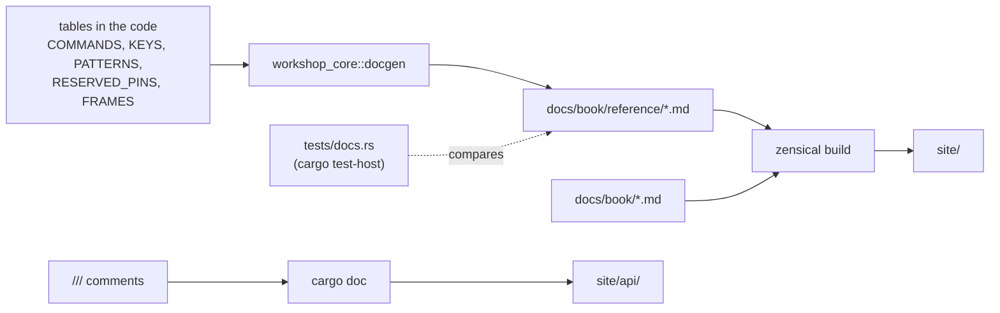

# Formatting and generated docs

Two routines keep the project tidy: **formatting** (one command) and
**documentation generated from the code** (so it can't drift from it, checked by
CI).

## Formatting

```sh
python3 scripts/dev.py format            # format everything
python3 scripts/dev.py format --check    # only check, change nothing
```

CI checks the formatting (`cargo fmt --all -- --check`, job **format**): an
unformatted push fails. Run `python3 scripts/dev.py format` before committing.

| Language | Tool | Scope | Settings |
|---|---|---|---|
| Rust | `cargo fmt --all` (rustfmt) | the whole workspace: firmware, `workshop-core`, tests | `rustfmt.toml`: 120 columns, `use_small_heuristics = "Max"` |
| Python | `black --line-length 100` | `scripts/` | line length 100 |

On top of formatting, **clippy** runs with `-D warnings` (any warning fails), and
the workspace sets a few lints in `Cargo.toml`:

| Lint | Level | Why |
|---|---|---|
| `rustdoc::broken_intra_doc_links` | deny | a link like [`NodeConfig`] to something that doesn't exist fails the docs build |
| `missing_docs` (in `workshop-core`) | warn | every public item of the core is documented |
| `clippy::mem_forget` (firmware binaries) | deny | esp-hal drivers rely on `Drop` to leave the hardware in a sane state |

## Documentation generated from the code

The site has three kinds of pages:

| Kind | Where | Written by | Kept up to date by |
|---|---|---|---|
| Guides | `docs/book/*.md` | hand | review |
| Reference | `docs/book/reference/*.md` | `workshop_core::docgen` | a test that fails when they're stale |
| API | `site/api/` (not committed) | `cargo doc` from the `///` comments | rebuilt by CI on every push |



### The reference pages

The firmware already holds the facts the reference pages describe: the CLI help
table, the settings and their ranges, the frame formats, the reserved pins, the
color patterns. `workshop_core::docgen` turns them into Markdown:

| Page | Generated from |
|---|---|
| `reference/cli.md` | `cli::COMMANDS`: usage, aliases, summary, details, examples (the same table as the `help` command) |
| `reference/config.md` | `config::KEYS` and `Key::describe()`: meaning, accepted values, defaults from `NodeConfig::DEFAULT` |
| `reference/protocol.md` | frame formats, field descriptions, and examples taken from `test_vectors::FRAMES` (checksums verified by the tests) |
| `reference/pins.md` | default pins, `RESERVED_PINS` (with the reason for each) and `MISSING_PINS` |
| `reference/patterns.md` | `fx::PATTERNS`: names, descriptions, color swatches |

Each page starts with a comment saying it's generated. **Don't edit them by
hand**: change the code, then regenerate.

### The freshness check

`crates/workshop-core/tests/docs.rs` regenerates every page in memory and compares
it with the committed file. It runs with the host tests, so in CI too: adding a
command, a setting or a pin rule without updating the docs **fails the build**.

```sh
UPDATE_DOCS=1 cargo test-host               # rewrite the pages from the code
python3 scripts/dev.py test host -u         # same thing
git add docs/book/reference                 # and commit them with the code change
```

### Examples that are tests

Code blocks in `///` comments are compiled and run by `cargo test-host` (16 of
them). An example that no longer matches the API fails the tests instead of
misleading a reader.

### The site

[Zensical](https://zensical.org) builds `docs/book/` into `site/`, with the
settings of `zensical.toml` and the theme overrides of `docs/templates/`.

```sh
python3 scripts/dev.py docs serve --open    # http://localhost:3000, rebuilt on each change
python3 scripts/dev.py docs build -r        # regenerate the reference pages, then build
python3 scripts/dev.py docs api --open      # rustdoc of the core and the firmware
```

## In CI, on every push

`.github/workflows/ci.yml`:

1. **format**: `cargo fmt --all -- --check`;
2. **host-tests**: `cargo test-host` (including the freshness check) and clippy on
   the core;
3. **firmware**: release build of both nodes and clippy, for four Cargo feature
   combinations (default, none, all, `rtt` alone);
4. **site** (only if 1 to 3 pass): `zensical build --clean`, then `cargo doc` for
   both crates, copied into `site/api/core/` and `site/api/firmware/` (separate
   folders: two rustdoc outputs in one folder would overwrite each other's search
   index);
5. **deploy** (pushes to `main` only): publishes `site/` on GitHub Pages.

So the published documentation always matches the last commit of `main`, and
a commit can't reach `main` with stale reference pages.

## Checklist: when you change…

| You change | Then |
|---|---|
| a CLI command, its help text or examples | `UPDATE_DOCS=1 cargo test-host`, commit `docs/book/reference/cli.md` |
| a setting, its range or default | same, for `config.md` (the tests also check that the documented range is the enforced one) |
| a frame format | update `test_vectors::FRAMES` (with independently computed checksums), then regenerate `protocol.md` |
| a pin rule | regenerate `pins.md`; `docgen` fails a test if a reserved pin has no reason |
| a color pattern | regenerate `patterns.md`; regenerate `COLORS` if the fade math changed |
| anything | `python3 scripts/dev.py format` then `python3 scripts/dev.py check` before pushing |
