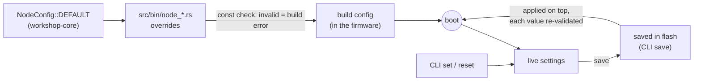

# Configuration

Settings live in several places because they answer different questions. Each
place has a single job:

| Question | Where | When it applies |
|---|---|---|
| **What is compiled into the firmware?** | Cargo features, in `Cargo.toml` | build |
| **What must both nodes agree on?** | `config::shared` (`crates/workshop-core/src/config.rs`) | build |
| **What does this node do by default?** | its `NodeConfig`, in `src/bin/node_a.rs` / `node_b.rs` | build |
| **What did I change and keep?** | flash, written by the CLI `save` | every boot |
| **What do I want to try right now?** | the CLI: `set`, `reset` | until reboot |
| How do the esp-rs crates behave? | `.cargo/esp-config.toml` | build |
| How is it built, flashed, debugged? | `rust-toolchain.toml`, `.cargo/config.toml`, `Embed.toml` | your computer |

## How a node gets its settings



Precedence, lowest first: **build config → saved settings → `set`**. `reset`
goes back to the build value; `forget` erases what was saved; `reboot` drops what
wasn't.

The same validation runs everywhere: `NodeConfig::validate()` is a `const fn`, so
it checks the node files at compile time, every `set` at run time, and every saved
value at boot. A value the build would refuse can't reach the hardware through the
CLI or the flash.

## Cargo features: what is compiled in

```sh
cargo build --release                                   # default: persist + watchdog
cargo build --release --features rtt                    # + RTT console
cargo build --release --no-default-features             # minimal: none of them
cargo build --release --no-default-features --features rtt
```

| Feature | Default | What it adds | Cost |
|---|---|---|---|
| `persist` | on | CLI `save` / `forget`; saved settings applied at boot | esp-storage; ~50 ms per `save` (one flash sector erased and written) |
| `watchdog` | on | TIMG0 watchdog: the chip resets if the main loop stalls for 2 s (`WATCHDOG_MS`) | none at run time (one register write per loop) |
| `rtt` | off | RTT console through the debug probe; the `console` setting then chooses serial, RTT or both | rtt-target, 4 KB of RAM for the buffers |

Features are **additive**: each one adds a capability and never changes what the
others do, so any combination builds. CI builds and lints four combinations
(default, none, all, `rtt` alone).

The boot card shows the features a firmware was built with, under **system**:

```text
├─ system · cargo features and saved settings ─────────────────┤
│  features  persist ✓ · watchdog ✓ · rtt ✗                    │
│  saved     2 setting(s) applied from flash                   │
│  changed   2 setting(s) differ from the build · `config`     │
│  watchdog  TIMG0 · reset if the loop stalls 2 s              │
│  console   auto                                              │
```

!!! tip "Feature or setting?"
    A **feature** when the code or a dependency shouldn't exist at all in some
    builds (a driver, a protocol stack, debug tooling). A **setting** when the
    code is always there and only its behavior changes. Never use features to pick
    a node or a board: they unify across the workspace and can end up enabled
    together. Use one binary per variant instead, as `node-a` / `node-b` do.

## Shared settings: what both nodes must agree on

`config::shared` holds the settings that break the link if the nodes disagree:
today, the boot baud rate (`shared::BAUD_RATE`, 5 Mbaud). They are constants of
the core crate, compiled into both binaries, so both always get the same value.

The `baud` command changes the speed at run time, but through a handshake with the
peer, never as a local setting.

## Node config: what each node does by default

Each binary is its configuration plus one macro call:

```rust
use esp32_rust_workshop::config::{Console, LedMode, NodeConfig};

const CONFIG: NodeConfig = NodeConfig {
    name: "node-A",
    data_period_ms: 1000.0,
    led1: LedMode::PeerButton,
    console: Console::Serial,
    ..NodeConfig::DEFAULT     // everything else: the defaults
};

esp32_rust_workshop::node_firmware!(CONFIG);
```

- `..NodeConfig::DEFAULT` takes every field you don't name from the defaults,
  so a node file lists only what makes that node different.
- `node_firmware!` adds `const _: () = CONFIG.check();`: a bad value is a **build
  error** with a message (`config: a pin is reserved (flash, USB, console or RGB LED)`),
  not a crash on the board.
- The [settings reference](reference/config.md) lists every field, its range and
  its default; it is generated from the code.

Two kinds of fields:

| Kind | Examples | Change it |
|---|---|---|
| **Runtime** | periods, LED modes, RGB pattern, `tx_mode`, `console`, `verbose` | in the node file, or live with `set` |
| **Read-only** | `name`, `pins.*` | node file only: the pins are wired to peripherals at boot, and the name identifies the node (and its saved settings) |

## Saved settings: what you changed and keep

With the `persist` feature (on by default):

```text
set rgb.pattern ocean
set data_period_ms 1000
save        ✓ saved 2 setting(s): applied at every boot (`forget` to erase)
reboot      … boot card: "saved  2 setting(s) applied from flash"
```

| Command | Effect |
|---|---|
| `save` | stores the settings that differ from the build config |
| `forget` | erases them; the next boot uses the build config |
| `config` | shows every setting: live value and build value |
| `reset [key]` | back to the build value now (then `save` to keep that) |
| `reboot` | software reset |

What happens under the hood (`workshop_core::persist`, tested on the host):

- **Only differences are stored**, as the text `set` accepts (`rgb.pattern=ocean`).
  A new firmware with new defaults applies them to everything you didn't save.
- **Every value is re-validated** at boot through `NodeConfig::set`. A setting the
  new firmware doesn't know, or a value it refuses, is skipped and counted on the
  boot card (`skipped`), never misread.
- **Integrity**: a header (`WSC1`, length, CRC-32). A damaged record is ignored
  as a whole.
- **Per node**: the record holds the node name. node-B firmware on a board that
  saved node-A's settings ignores them.
- **Where**: the first 4 KB sector of the `nvs` partition (0x9000). This firmware
  doesn't use ESP-IDF's NVS, so the area is free. `espflash flash` doesn't write
  it, so **saved settings survive reflashing**; `python3 scripts/dev.py erase a`
  wipes them along with everything else.

## esp-rs crate settings

esp-hal, esp-println and the bootloader crate read their own options at build
time, from `ESP_<CRATE>_CONFIG_<OPTION>` environment variables.
`.cargo/esp-config.toml` sets them (it's included by `.cargo/config.toml`); this
project keeps the defaults. Each crate lists its options in its `esp_config.yml`.

## Toolchain, build and tools

| File | Holds |
|---|---|
| `rust-toolchain.toml` | Rust channel (stable), the RISC-V target, `rust-src`. rustup installs them on the first `cargo` command |
| `Cargo.toml` | workspace, shared versions (`[workspace.package]`, `[workspace.dependencies]`), features, profiles (`opt-level = "s"`, fat LTO) |
| `.cargo/config.toml` | default target, `cargo run` = espflash, aliases `test-host` / `test-target`, frame pointers for backtraces |
| `Embed.toml` | cargo-embed: RTT console only, flashing disabled (see the [probe-rs pitfall](guide-rust.md#flash-run-debug)) |
| `rustfmt.toml`, `.clippy.toml`, `.editorconfig` | code style, checked by CI |
| `.boards.json` | which board (by MAC) is node A or B on your desk; written by `dev.py boards assign`, not committed |

## Where to change what

| I want to… | Do |
|---|---|
| try another RGB pattern | `pattern ocean` (CLI) |
| keep it after a reboot | `save` |
| make it the default of node A, for everyone | `rgb: RgbConfig { pattern: "ocean", ..NodeConfig::DEFAULT.rgb }` in `src/bin/node_a.rs` |
| move the button to another GPIO | `pins: Pins { button: 5, ..NodeConfig::DEFAULT.pins }` in the node file (the build checks the pin) |
| change the link speed for good | `shared::BAUD_RATE`, then rebuild **both** nodes |
| change the link speed now | `baud 1M` (both nodes switch together) |
| read the console through the probe | build with `--features rtt`, then `set console rtt` |
| a firmware without flash writes | `--no-default-features --features watchdog` |
| change a setting of esp-hal | `.cargo/esp-config.toml` |

## Adding a setting or a feature

**A runtime setting**: add the field to `NodeConfig` and its default, a check in
`validate()`, a `Key` with its name in `KEYS`, its `describe()` line, and its arms
in `set` / `write_value`. Then `UPDATE_DOCS=1 cargo test-host`. The tests check
that it round-trips through `set`, through `reset`, and through `save`, and that its
documented range is the enforced one.

**A Cargo feature**: declare it in `[features]` (with `dep:` for an optional
dependency), keep the firmware building without it (a no-op stand-in, as
`settings::Store` or `Watchdog` do, beats `#[cfg]` everywhere), show it in the boot
card's `features` row, add it to the CI matrix, and document it in the table above.

!!! note "Wi-Fi and BLE"
    [esp-radio](https://docs.espressif.com/projects/rust/esp-radio/1.0.0-beta.2/esp32s31/esp_radio/index.html)
    (Espressif's Rust radio stack) has an ESP32-S31 build with Wi-Fi and ESP-NOW, in
    beta; BLE isn't listed for the S31 there yet. It needs a heap (`esp-alloc`), a
    preemptive scheduler (`esp-rtos`) and `opt-level` 2 or 3 for the radio blobs
    (this project builds with `"s"`). It would fit here as a `wifi` feature, with
    the SSID as a read-only setting and the password kept out of the repository.
