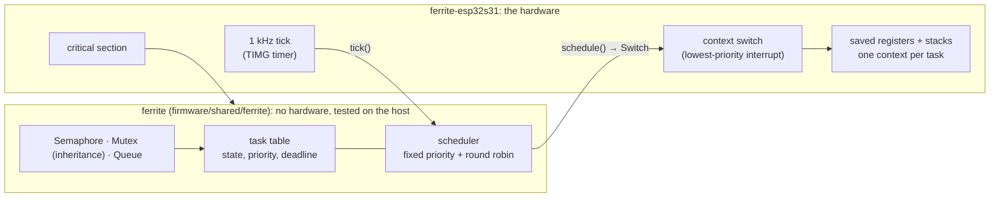

# Ferrite: an RTOS in Rust

Ferrite is a small **preemptive real-time kernel** written for this project, in `no_std` Rust, with a port for the
ESP32-S31. It is the start of replacing the two ways the apps schedule their work today (the UART app's blocking
loop, the Ethernet app's `esp-rtos` + Embassy) with a scheduler the project owns and can test.

!!! info "Status: the kernel is tested, the port ran its demo for 21 minutes"
    - **Kernel** (`firmware/shared/ferrite`): finished for a first version, **13 tests + 1 doc test on the host**.
    - **ESP32-S31 port** (`firmware/ferrite-esp32s31`): the demo ran on a board for **over 21 minutes (1.27 million
      ticks)** with no fault. What that showed: tick, context switch, preemption, `delay`, the queue's blocking
      `send`/`recv`, and round robin (the two spinners' counters stayed within 0.1 %, at about 104 switches
      a second, as 10 ms slices plus the periodic tasks predict).
    - **A second, self-checking test (`stress`)** ran on the board and passes: floating-point registers kept across
      switches, priority inheritance, semaphore and timeouts (details [below](#the-self-checking-test)). It was
      also checked to be able to fail (see there).
    - **Not exercised on hardware yet:** the wrap of the tick counter (after 49 days), a `give` from an interrupt
      handler, stack overflow, many tasks at once (12 is the table size).
    - **The Ethernet app can run on it** (feature `ferrite`, no async code), written but not run on two boards yet; the UART app does not use it. See [Moving the Ethernet app onto Ferrite](#moving-the-ethernet-app-onto-ferrite).

## Design



The split is the point. The kernel is **plain data and rules**: a fixed table of `N` tasks, no `unsafe`, no allocation,
no dependency. A call like `delay`, `wake_one` or `tick` only updates the table; it never switches by itself.
The port then calls `schedule()`, which answers *"save task A, run task B"* (or *"keep going"*), and does the
register work. That is why the scheduling rules can be checked with ordinary `cargo test` on a computer.

| | |
|---|---|
| **Scheduling** | fixed priorities, 0 (idle) to 31; the most urgent ready task runs |
| **Preemption** | a task that becomes ready and is more urgent than the running one takes over at once |
| **Round robin** | tasks of equal priority take turns, every `TIME_SLICE_TICKS` (10 ticks = 10 ms) |
| **Time** | a 32-bit wrapping tick (1 kHz); delays and time limits are compared across the wrap |
| **Tasks** | a fixed table (`MAX_TASKS` = 12, the idle task included); stacks are `static`, given by the application |
| **Synchronization** | counting semaphore, mutex with **priority inheritance**, bounded message queue |
| **Waking rule** | a woken task *retries* its operation (no token hand-over), so a more urgent task can't be cheated |

### The synchronization objects

They are values you put in a `static`. Each has a non-blocking operation and a call that blocks the running
task on it; the port's `sync` module turns that into `take(timeout)`, `lock(timeout)`, `send(item, timeout)`,
`recv(timeout)`.

- **`Semaphore`**: tokens, a maximum; `give` wakes the most urgent waiter.
- **`Mutex`**: while a more urgent task waits for it, its holder runs at that task's priority, so a task of middle
  priority can't starve the holder (priority inversion). One hop only, and `unlock` returns the holder to its base
  priority. Locked through a guard (`Guard`), unlocked on drop.
- **`Queue<T, CAP>`**: first in, first out; `send` waits for room, `recv` waits for a message.

### The context switch

A switch is an **interrupt return**. `esp-hal` lets an RTOS register a handler that runs at the lowest interrupt
priority; the port's handler (`context.rs`, about 100 lines of RISC-V assembly) saves all 31 integer registers, `mepc`
and, with the `fpu` feature (on by default), `fcsr` and `f0-f31` into the running task's `Context`, calls
the kernel, loads the next task's registers and executes `mret`. A task that calls `delay` is therefore
stopped *inside* that call (a software interrupt is requested there), and returns from it when it runs again.
The approach follows what `esp-rtos` does, which is the documented way to plug an RTOS into `esp-hal`.

!!! note "The floating-point registers need a Cargo feature, not `cfg(target_feature)`"
    On stable Rust `cfg(target_feature = "f")` is always false for the RISC-V `F` extension (the feature is
    unstable), so a first version silently saved no float registers. The port uses the `fpu` Cargo feature instead,
    and the disassembly contains the 66 `fsw`/`flw`/`frcsr`/`fscsr` instructions.

## Try it

The kernel, anywhere:

```sh
cargo test-host                      # includes Ferrite: scheduling, preemption, time slices, wrap-around,
                                     #   semaphore, priority inheritance, queue
cargo test -p ferrite --target host-tuple
```

The demo, on a board (its own Cargo workspace, like the Ethernet app: it builds on `esp-hal` `main`):

```sh
cd firmware/ferrite-esp32s31
cargo run --release --example demo
```

Five tasks: a 500 ms `ticker` (priority 6), a `producer` and a `consumer` joined by a queue (4 and 3), and two
spinners that never block (2). If the kernel and the port work, the console shows the consumer receiving a number each
second, and the spinners' loop counters, printed every 5 s, growing at about the same pace: that is the round robin.
Measured on a board (from the 21-minute run):

```text
[1255000 ms] ticker: spin-a 2782999203 loops, spin-b 2785798101 loops, 130521 task switches
[1260000 ms] ticker: spin-a 2811197525 loops, spin-b 2814008116 loops, 131041 task switches
[1265000 ms] ticker: spin-a 2839397267 loops, spin-b 2842218131 loops, 131561 task switches
```

Per 5 s: 28.2 million loops each, 520 switches (100 a second between the spinners, the rest for the other tasks), and
the `ticker` prints on the exact millisecond every time.

## The self-checking test

`cargo run --release --example stress` (in `firmware/ferrite-esp32s31`) runs eight tasks and prints a PASS or FAIL line
every 5 s:

| What | How | Passes when |
|---|---|---|
| **Float registers** | two tasks sum 1000 floats in a loop, forever, while the kernel switches between them 100 times a second | every sum is exactly right |
| **Priority inheritance** | each second: `low` (3) holds a mutex for 300 ms, `mid` (4) hogs the processor from 150 to 750 ms, `high` (5) asks for the mutex at 100 ms | `high` waits at most 350 ms |
| **Semaphore, timeouts** | `giver` (7) gives a token each second, `taker` (6) waits for one at most 400 ms | a timed-out wait lasts 400 to 403 ticks, a token is taken within 2 ticks of being given |

On a board it reports, after 25 s: `floats 65489 ok 0 bad | inversion 25 cycles, high waited 200..200 ms | semaphore 25 taken 52 timed out, 0 late, 0 wrong timeouts | PASS`.

A test is only worth something if it can fail, so it was run twice with the feature deliberately broken, on the same board:

| Broken on purpose | Result |
|---|---|
| priority inheritance off (`boost` does nothing) | `high waited 650..650 ms`, every cycle bad: the 650 ms the scenario predicts without inheritance |
| float registers not saved (`--no-default-features`) | `floats 325 bad` out of 30000: corrupted sums |

## Moving the Ethernet app onto Ferrite

The Ethernet app can now run **without any async code**: `cargo build --release --features ferrite` (from
`firmware/ethernet/`) builds the node on Ferrite instead of `esp-rtos` + Embassy. The Embassy runtime is still the default
and is untouched, so the two can be compared on the same boards.

!!! warning "Status: builds, not run on two boards yet"
    The Ferrite runtime compiles, passes clippy, and builds for UDP and TCP presets and every feature combination
    (it is a CI matrix entry). It has **not run on a board yet** (both were busy when it was written): use the
    checklist below before trusting it.

### How it is built

```text
  node task      the main loop: node.step() then yield_now(), forever          (same Node as before)
  net task       owns the EMAC and smoltcp; each turn: poll the stack, serve the UDP/TCP socket, yield
  console task   moves the print pipe to the USB FIFO, yield when it is empty
```

- **No executor, no futures.** What waited with `.await` is now a task that polls and gives the processor
  up (`yield_now`). The three tasks have the same priority, so they take turns, as the futures did.
- **smoltcp directly.** `embassy-net` is smoltcp behind an async runner. The EMAC driver in `esp-hal` also has a
  *blocking* mode (`receive`, `transmit`, `poll_link`), so `rt.rs` wraps it as a smoltcp `Device` (a received frame is copied out of
  the DMA ring at once) and the net task runs `Interface::poll` itself. The sockets, the line framing and the
  connect/retry logic of TCP are the same as in the Embassy tasks, written as a function called on each turn.
- **Unchanged:** `Node`, the CLI, the frames, the address space, the settings, the TX/RX queues between the node and the
  network (they are `embassy-sync` channels, which work without an executor), the counters, the console pipe.
- **Differences to know:** the PHY is read every 500 ms by the net task; there is no DMA interrupt wake-up (the net
  task polls on every turn); the console task has no 200 µs sleep when the USB FIFO is full, it yields instead.

### Checklist before it becomes the default

Flash one board with the Ferrite build and the other with the default one first (they speak the same frames), then both
with Ferrite:

```sh
cd firmware/ethernet
cargo run --release --features ferrite --bin node-a      # board A on Ferrite
cargo run --release --bin node-b                         # board B on Embassy
```

| Check | Expect |
|---|---|
| boot card, then `cable connected: 1 Gbit/s · full duplex` | as on Embassy |
| frames in both directions (`verbose frames`) | `DAT` every period, `lost 0` |
| `burst 20000 max`, `burst 5000 1kHz` | 0 lost |
| `tx on-rx` on B, `rtt` on A | compare with the Embassy figures (about 4 ms): Ferrite polls on every turn, so it should not be worse |
| TCP presets (`PRESET_NODE_A=node-a-tcp PRESET_NODE_B=node-b-tcp`) | connects, `link` shows it, a burst passes; unplug and replug the cable: it reconnects |
| CLI, `save`/`forget`, `reboot`, `browse / 2` | as before |
| `link` and the status line: `main loop` rate, `slowest` | the loop rate is about the same order as before |
| watchdog | doesn't reset (the node loop keeps running) |

### The plan

1. **Done:** the Ferrite runtime behind the `ferrite` feature, in CI; the Embassy runtime stays the default.
2. **Next:** the checklist above, on two boards, UDP then TCP, Ferrite against Embassy then against itself.
3. **Then:** measure and tune: a wake-up on the DMA interrupt instead of polling on every turn (less CPU, the same latency),
   priorities (the net task above the node task), the console's back-pressure.
4. **Then:** make `ferrite` the default and delete the Embassy runtime (`run`, `udp_task`, `tcp_task`, `net_task`, the `esp-rtos`,
   `embassy-executor`, `embassy-net` dependencies).
5. **The UART app** stays on its blocking loop: Ferrite's port needs `esp-hal` `main`, and the UART app is on the 1.2 release
   from crates.io. It moves when a release has the S31 RTOS hooks, or when the two apps share one workspace.

## What is missing

Single core only (the S31's second core is not used). Priority inheritance follows one hop. Ready tasks are found by
scanning the table (fine for a dozen). No tickless idle yet, though the kernel already computes the time to the next
event (`ticks_to_next_event`). No stack-overflow detection. No interrupt-safe `give` from an interrupt handler
other than through the critical section.
