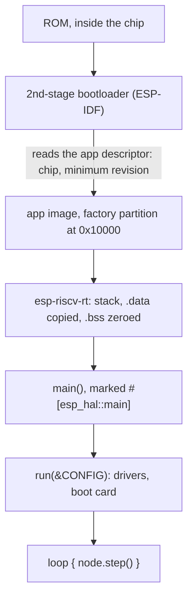
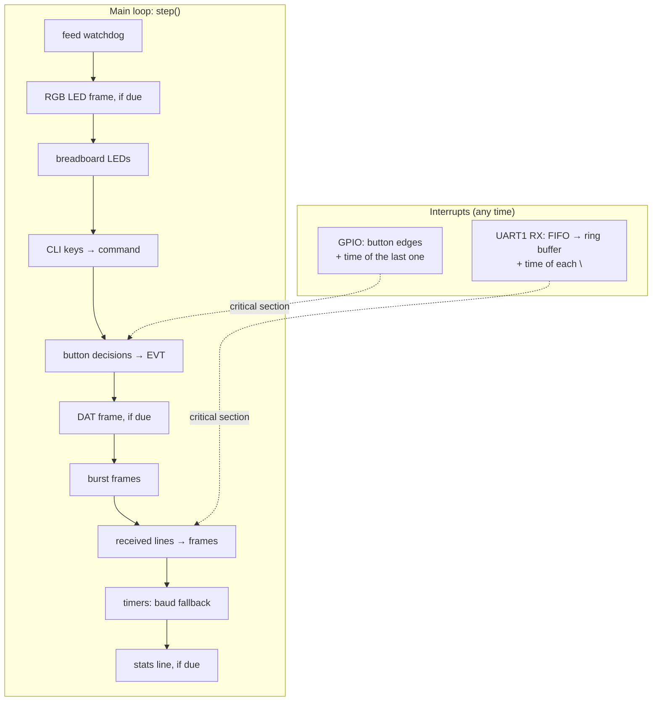

# Firmware walkthrough

A guided tour of `firmware/uart/src/`, the part of the project that touches the hardware. Each
block of code below is **included from the source file** when the site is built:
what you read is what is compiled.

The hardware-free logic (frame format, debouncing, settings, CLI parsing) lives in
`firmware/shared/core` and is covered on the [Examples](examples.md) page. This
page is about the rest: peripherals, interrupts, memory, and how they fit in a
`no_std` program with no operating system.

| File | Role | Peripherals |
|---|---|---|
| `firmware/uart/src/bin/node_a.rs`, `node_b.rs` | one binary per node: its config | none |
| `firmware/uart/src/lib.rs` | boot (`run`), the main loop (`Node::step`), watchdog | TIMG0 |
| `firmware/uart/src/link.rs` | UART link at 5 Mbaud, interrupt-driven reception | UART1, GPIO2, GPIO3 |
| `firmware/uart/src/button.rs` | jumper and BOOT button on GPIO interrupts | IO_MUX, GPIO4, GPIO61 |
| `firmware/uart/src/settings.rs` | settings saved in flash | FLASH |
| `firmware/uart/src/led.rs`, `fx.rs` | RGB LED, fade patterns | RMT, GPIO60 |
| `firmware/uart/src/ext_leds.rs` | the two breadboard LEDs | GPIO20/21 |
| `firmware/uart/src/trng.rs` | starts the true random number generator | LP_TRNG (raw registers) |
| `firmware/uart/src/cli.rs` | key presses from USB and RTT into the CLI | USB_DEVICE |
| `firmware/uart/src/term.rs`, `rtt_console.rs` | console output, its routing to USB and RTT | none (esp-println, RTT) |

## 1. From reset to `main`



A node binary is three lines of real code: its config, and one macro call.

```rust title="firmware/uart/src/bin/node_a.rs"
--8<-- "firmware/uart/src/bin/node_a.rs"
```

The macro expands to everything a bare-metal Rust program needs:

```rust title="firmware/uart/src/lib.rs"
--8<-- "firmware/uart/src/lib.rs:macro"
```

| Line | What it does |
|---|---|
| `use esp_backtrace as _;` | links the **panic handler**: every `no_std` binary needs exactly one. On a panic, esp-backtrace prints the message and a backtrace (espflash decodes the addresses into function names), then halts: an endless loop with interrupts disabled |
| `const _: () = $config.check();` | runs `NodeConfig::check` **at compile time**: a bad pin or period is a build error |
| `esp_app_desc!()` | the **app descriptor**: a struct at a fixed place in the image that the ESP-IDF bootloader reads (magic number, chip, minimum chip revision, versions) before it agrees to start the app |
| `#[esp_hal::main]` | marks the entry point. There is no `fn main()` in the usual sense (`#![no_main]`): the runtime calls this after setting up the stack and memory |
| `fn main() -> !` | never returns: there's no operating system to return to |

!!! info "`#![no_std]` and `#![no_main]`"
    `no_std`: no standard library, only `core` (no heap, no threads, no files).
    Strings are `heapless::String<N>` (fixed capacity, on the stack or in a
    `static`), collections are `heapless::Deque` / `Vec`. `no_main`: the program
    doesn't start through Rust's usual `main` machinery; the runtime
    (`esp-riscv-rt`) provides the reset vector and calls the function marked
    `#[esp_hal::main]`.

## 2. `run()`: taking the peripherals

```rust title="firmware/uart/src/lib.rs"
--8<-- "firmware/uart/src/lib.rs:run"
```

`esp_hal::init` sets the clocks (CPU at 320 MHz with `CpuClock::max()`) and
returns `Peripherals`: one field per peripheral (`UART1`, `RMT`, `TIMG0`, each GPIO).
Each driver **takes** its peripheral by value:

```rust
let link = Link::new(peripherals.UART1, …);   // UART1 moved into the driver
let other = Uart::new(peripherals.UART1, …);  // error[E0382]: use of moved value
```

!!! tip "Peripherals are singletons, checked by the compiler"
    Two drivers can't own the same hardware block: the second `peripherals.UART1`
    doesn't compile. That's the same ownership rule as for any Rust value, used to
    rule out a whole class of embedded bugs (two pieces of code reconfiguring the
    same UART) at compile time.

The pins from the config are numbers, not fields, so they go through `pin()`:

```rust title="firmware/uart/src/lib.rs"
--8<-- "firmware/uart/src/lib.rs:pin"
```

`AnyPin::steal` creates a pin from its number, skipping the ownership check, hence
`unsafe`. What makes it sound is `NodeConfig::check`, at compile time: every pin of
the config is distinct, exists, and isn't reserved (flash, USB, console, RGB LED,
audio, BOOT).

**Order matters** in `run()`:

1. RTT first, so that even the boot card can go to the probe;
2. the settings saved in flash before the console route is set (it's one of them);
3. drivers, then the boot card;
4. the **watchdog last**, as the final field of `Node`: printing the boot card can
   take a while, and the watchdog must not fire before the loop runs.

```rust title="firmware/uart/src/lib.rs"
--8<-- "firmware/uart/src/lib.rs:loop"
```

## 3. The main loop

No operating system, no async runtime: one loop, which calls `step()` as fast as
it can. Each part does a little work and returns; nothing waits.

```rust title="firmware/uart/src/lib.rs"
--8<-- "firmware/uart/src/lib.rs:step"
```



| Part | Order of magnitude | Why it's fine |
|---|---|---|
| RGB LED frame | ~30 µs (RMT, 24 bits) | only every `1 / rgb.freq_hz` (20 ms at 50 Hz) |
| button, LEDs, timers | a few µs | register reads and writes |
| a frame line on the console | 0.1 to 1 ms | USB is slow; reception goes on in the UART interrupt meanwhile |
| a `burst max` slice | ≤ 2 ms (`BURST_SLICE_US`) | a long burst is sent in slices, so the rest of the loop keeps running |
| `save` | ~50 ms | one flash sector erased and written, on demand only |

!!! question "Why not async (Embassy) or an RTOS?"
    A super-loop is the simplest model that works here: every task is short, and
    the one with a hard deadline (reception at 5 Mbaud) is handled by an
    interrupt. [Embassy](https://embassy.dev) would let each part be written as a
    sequence (`uart.read(..).await`), at the cost of an executor, and esp-hal
    supports it (`Async` drivers). Wi-Fi or BLE would need `esp-rtos` anyway. For
    this firmware, the loop keeps every timing visible and testable.

The watchdog fed at the top of `step()`:

```rust title="firmware/uart/src/lib.rs"
--8<-- "firmware/uart/src/lib.rs:watchdog"
```

TIMG0's watchdog counts down from 2 s; `feed()` restarts it. If one `step()` ever
takes longer (a deadlock, an infinite loop), the chip resets; the boot card's
`reset` row then names the watchdog (`CoreMwdt0` in esp-hal's list of reset
reasons). With the feature off, the struct has no field and
`feed()` compiles to nothing: no `#[cfg]` at the call site.

## 4. UART at 5 Mbaud

At 5 Mbaud a byte lasts 2 µs, and the UART's hardware FIFO holds 128 bytes: it
fills in **256 µs**. The main loop can't promise to come back that often (one
console line takes longer), so an **interrupt** empties the FIFO into a 2 KB ring
buffer, and the loop reads that buffer whenever it gets there.

### Shared state

```rust title="firmware/uart/src/link.rs"
--8<-- "firmware/uart/src/link.rs:statics"
```

The interrupt handler is a plain function: it can't receive arguments, so what it
shares with the main loop lives in `static`s.

| Type | Used for | Why this one |
|---|---|---|
| `Mutex<RefCell<Option<Uart>>>` | the driver itself | created in `Link::new`, after the `static` (hence `Option`), and borrowed mutably by both sides (hence `RefCell`) |
| `Mutex<RefCell<Deque<u8, 2048>>>` | the ring buffer | written by the interrupt, read by the loop |
| `AtomicU32` | counters, the baud rate | one word: atomic loads and stores, no lock needed |

!!! info "`critical_section::Mutex`: a lock that masks interrupts"
    `critical_section::with(|cs| …)` runs the closure with interrupts disabled, and
    hands it a token `cs` that proves it. `Mutex::borrow(cs)` only accepts that
    token: you can't touch the data outside a critical section. Since the loop
    holds the lock with interrupts off, the interrupt can't fire in the middle of
    a read, and on this single-core setup that makes the access exclusive.
    Keep these sections short: an interrupt pending meanwhile waits for the end.

### The interrupt handler

```rust title="firmware/uart/src/link.rs"
--8<-- "firmware/uart/src/link.rs:isr"
```

- **When it fires**: the FIFO holds 64 bytes (`RxFifoFull`, half full: 128 µs of
  margin left at 5 Mbaud), or the line has been idle for 10 character times
  (`RxTimeout`, 10 × 2 µs = 20 µs at 5 Mbaud: the end of a frame).
- **Bounded**: at most 8 reads of the FIFO per interrupt, never a `loop` that a
  noisy line could keep alive.
- **Timing**: it reads the clock once, then dates each `\n` by counting back the
  bytes read after it (2 µs each at 5 Mbaud), and the idle timeout when that's
  why it fired. Those times give the `Δ` column of the console with µs resolution,
  whatever the main loop was doing. The math is in `workshop_core::wire`, tested
  on the host.
- **Overflow**: a full ring buffer counts dropped bytes instead of blocking; the
  loop reports them (`RX buffer full, bytes dropped`). 2 KB is 4 ms of continuous
  traffic at 5 Mbaud.

### Setup and sending

```rust title="firmware/uart/src/link.rs"
--8<-- "firmware/uart/src/link.rs:init"
```

`listen()` and `replace()` happen inside one critical section: the interrupt can't
fire between them and find no driver. The handler is registered with
`set_interrupt_handler`; `#[handler]` on `on_uart1` generates the interrupt entry
point (saving registers, priority).

```rust title="firmware/uart/src/link.rs"
--8<-- "firmware/uart/src/link.rs:send"
```

A frame (< 100 bytes) fits in the 128-byte TX FIFO, so `send` doesn't wait for the
wire: it queues and returns the time the last byte **will** leave
(`len × 10 bits / baud`). The `Δ` of sent frames uses that time, so TX and RX
deltas share one clock.

### From bytes to frames

The loop side: drain the ring buffer, cut it into lines, parse.

```rust title="firmware/uart/src/lib.rs"
--8<-- "firmware/uart/src/lib.rs:receive"
```

`LineBuffer` and `protocol::parse` come from `workshop-core`: see
[From a byte stream to frames](examples.md#from-a-byte-stream-to-frames).

!!! warning "A feature that changed timing: `esp-println/critical-section`"
    By default, esp-println takes a critical section around **every print**, so
    that output from an interrupt can't interleave with the loop's. A console line
    over USB can take a millisecond: interrupts off that long let the 5 Mbaud RX
    FIFO overflow. The feature is disabled in `Cargo.toml`; this firmware never
    prints from an interrupt, so nothing interleaves.

## 5. Buttons on GPIO interrupts

esp-hal has **one** interrupt handler for all GPIOs. With two buttons (the jumper
and BOOT), the handler checks each pin's own flag:

```rust title="firmware/uart/src/button.rs"
--8<-- "firmware/uart/src/button.rs:isr"
```

Same pattern as the UART: the handler only **records** (how many edges, when the
last one was); it decides nothing. The decision (debounce, lockout) is made in the
loop by `workshop_core::button::Debouncer`, tested on the host with simulated
bounces ([Examples](examples.md#debouncing-a-button)).

```rust title="firmware/uart/src/button.rs"
--8<-- "firmware/uart/src/button.rs:new"
```

`Gpio` owns `Io` (the IO_MUX driver) and installs the handler once; `Button::new`
takes a `&Gpio` it doesn't use, as a **proof** that the handler exists before a pin
starts listening. The type system enforces the order instead of a comment.

## 6. Settings in flash

```rust title="firmware/uart/src/settings.rs"
--8<-- "firmware/uart/src/settings.rs:store"
```

- **Where**: the partition table (at 0x8000) lists the partitions; the code looks
  for the `nvs` data partition (ESP-IDF's key-value store, unused by this
  firmware) and keeps its first 4 KB sector.
- **How**: `FlashStorage` (esp-storage) reads and writes the SPI flash. A write
  does read, erase, write of the whole 4 KB sector: the flash can only turn bits
  from 1 to 0, an erase sets them back to 1.
- **What**: the record format (only the settings that differ from the build,
  CRC-32, node name) is `workshop_core::persist`, tested on the host.

The same file shows how an **optional feature** stays out of the call sites:

```rust title="firmware/uart/src/settings.rs"
--8<-- "firmware/uart/src/settings.rs:stub"
```

Without `persist`, `Store` still exists with the same methods; they just say "not
built in". `lib.rs` calls `store.save(…)` the same way in every build, and the
compiler optimizes the stub away. The watchdog and RTT follow the same pattern.

## 7. LEDs: RMT and plain GPIO

```rust title="firmware/uart/src/led.rs"
--8<-- "firmware/uart/src/led.rs"
```

The RGB LED is a WS2812: one data wire, 24 bits per color, each bit a high pulse
of 0.4 or 0.8 µs. Timing that precise isn't done by toggling a GPIO from code:
the **RMT** peripheral (built for infrared remotes) plays a list of pulse
durations by itself, at 80 MHz (12.5 ns resolution). `esp-hal-smartled` turns
colors into those pulses. `memsize 2` gives the channel two RAM blocks, enough for
the 24 bits of one LED without refilling.

The breadboard LEDs are plain `Output` pins (`firmware/uart/src/ext_leds.rs`); what each mode
shows is decided in `workshop_core::leds`.

## 8. The TRNG: raw registers

```rust title="firmware/uart/src/trng.rs"
--8<-- "firmware/uart/src/trng.rs:trng"
```

esp-hal 1.2.2 reads random numbers on the S31 but never starts the generator; the
bootloader stops it before starting the app, so every key used to be identical.
These five writes mirror ESP-IDF's `trng_ll_enable()`.

- `read_volatile` / `write_volatile`: the compiler must not cache, merge or remove
  these accesses: each one is a real bus transaction on a hardware register.
- `unsafe`: a raw pointer to a fixed address. Sound here because the addresses come
  from the ESP32-S31 register map and nothing else touches these registers.
- Remove this file once esp-hal starts the TRNG itself.

## 9. The console: USB, RTT and the CLI

Output goes through one macro, routed at run time by the `console` setting:

```rust title="firmware/uart/src/rtt_console.rs"
--8<-- "firmware/uart/src/rtt_console.rs:macro"
```

- `$crate::` makes the macro work from any module (and any crate).
- `#[cfg(feature = "rtt")]` is evaluated in the crate that **uses** the macro: here
  the firmware itself, so it follows the firmware's features.
- `format_args!` formats without allocating, straight into the output.

Input: the CLI reads bytes from USB **and** from the RTT down channel, into the same
line editor:

```rust title="firmware/uart/src/cli.rs"
--8<-- "firmware/uart/src/cli.rs:poll"
```

`read_byte()` never blocks: it returns an `nb::Result`, and "no byte yet" is
`Err(nb::Error::WouldBlock)`, turned into `None` by `.ok()`; the loop moves on.

## The `unsafe` inventory

The whole firmware has two `unsafe` blocks, each with its justification next to it:

| Where | What | Why it's sound |
|---|---|---|
| `firmware/uart/src/lib.rs`, `pin()` | `AnyPin::steal(n)`: a GPIO from its number | `NodeConfig::check` proves at compile time that the configured pins are distinct, exist, and aren't used elsewhere |
| `firmware/uart/src/trng.rs`, `modify()` | volatile access to three MMIO registers | fixed addresses from the register map, touched nowhere else |

Everything else (interrupts, shared state, flash, DMA-free drivers) goes through
esp-hal's safe API and `critical_section`.

## Adding a peripheral: a recipe

1. **Logic first**: whatever doesn't need the hardware (a parser, a state machine, a
   conversion) goes in `firmware/shared/core`, with tests.
2. **A driver module** in `firmware/uart/src/`: it takes its peripheral by value in `new()`, so
   ownership proves nobody else uses it.
3. **Interrupt?** Share through `static Mutex<RefCell<…>>` (or atomics), keep the
   handler short and bounded, and let the loop decide.
4. **Pins**: add them to `Pins` in the config (checked at compile time) or, if they
   are fixed on the board, to `RESERVED_PINS` with a reason in `docgen`.
5. **Optional?** A Cargo feature with a stub implementation, as `settings.rs` does,
   added to the CI matrix.
6. **Show it**: a row in the boot card (`term::boot_card`), a section on this page.
