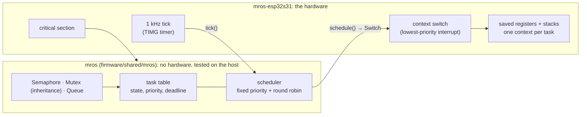

# mros: an RTOS in Rust

mros is a small **preemptive real-time kernel** written for this project, in `no_std` Rust, with a port for the
ESP32-S31. It is the start of replacing the two ways the apps schedule their work today (the UART app's blocking
loop, the Ethernet app's `esp-rtos` + Embassy) with a scheduler the project owns and can test.

!!! warning "Status: the kernel is tested, the port is not run yet"
    - **Kernel** (`firmware/shared/mros`): finished for a first version, **13 tests + 1 doc test on the host**.
    - **ESP32-S31 port** (`firmware/mros-esp32s31`): **builds** (release, clippy clean; the save half of the
      context switch was disassembled and its offsets checked), but **has not run on a board**: the two boards were busy when it was written.
      Treat the context switch as unverified until the demo below prints what it should.
    - **The apps do not use it yet.** See [Moving the apps onto mros](#moving-the-apps-onto-mros) for why and how.

## Design



The split is the point. The kernel is **plain data and rules**: a fixed table of `N` tasks, no `unsafe`, no allocation,
no dependency. A call like `delay`, `wake_one` or `tick` only updates the table; it never switches by itself.
The port then calls `schedule()`, which answers *"save task A, run task B"* (or *"keep going"*), and does the
register work. That is why the scheduling rules can be checked with ordinary `cargo test` on a computer.

| | |
|---|---|
| **Scheduling** | fixed priorities, 0 (idle) to 31; the most urgent ready task runs |
| **Preemption** | a task that becomes ready and is more urgent than the running one takes over at once |
| **Round robin** | tasks of equal priority take turns, every `TIME_SLICE_TICKS` (10 ticks = 10 ms) |
| **Time** | a 32-bit wrapping tick (1 kHz); delays and time limits are compared across the wrap |
| **Tasks** | a fixed table (`MAX_TASKS` = 12, the idle task included); stacks are `static`, given by the application |
| **Synchronization** | counting semaphore, mutex with **priority inheritance**, bounded message queue |
| **Waking rule** | a woken task *retries* its operation (no token hand-over), so a more urgent task can't be cheated |

### The synchronization objects

They are values you put in a `static`. Each has a non-blocking operation and a call that blocks the running
task on it; the port's `sync` module turns that into `take(timeout)`, `lock(timeout)`, `send(item, timeout)`,
`recv(timeout)`.

- **`Semaphore`**: tokens, a maximum; `give` wakes the most urgent waiter.
- **`Mutex`**: while a more urgent task waits for it, its holder runs at that task's priority, so a task of middle
  priority can't starve the holder (priority inversion). One hop only, and `unlock` returns the holder to its base
  priority. Locked through a guard (`Guard`), unlocked on drop.
- **`Queue<T, CAP>`**: first in, first out; `send` waits for room, `recv` waits for a message.

### The context switch

A switch is an **interrupt return**. `esp-hal` lets an RTOS register a handler that runs at the lowest interrupt
priority; the port's handler (`context.rs`, about 100 lines of RISC-V assembly) saves all 31 integer registers, `mepc`
and, with the `fpu` feature (on by default), `fcsr` and `f0-f31` into the running task's `Context`, calls
the kernel, loads the next task's registers and executes `mret`. A task that calls `delay` is therefore
stopped *inside* that call (a software interrupt is requested there), and returns from it when it runs again.
The approach follows what `esp-rtos` does, which is the documented way to plug an RTOS into `esp-hal`.

!!! note "The floating-point registers need a Cargo feature, not `cfg(target_feature)`"
    On stable Rust `cfg(target_feature = "f")` is always false for the RISC-V `F` extension (the feature is
    unstable), so a first version silently saved no float registers. The port uses the `fpu` Cargo feature instead,
    and the disassembly contains the 66 `fsw`/`flw`/`frcsr`/`fscsr` instructions.

## Try it

The kernel, anywhere:

```sh
cargo test-host                      # includes mros: scheduling, preemption, time slices, wrap-around,
                                     #   semaphore, priority inheritance, queue
cargo test -p mros --target host-tuple
```

The demo, on a board (its own Cargo workspace, like the Ethernet app: it builds on `esp-hal` `main`):

```sh
cd firmware/mros-esp32s31
cargo run --release --example demo
```

Five tasks: a 500 ms `ticker` (priority 6), a `producer` and a `consumer` joined by a queue (4 and 3), and two
spinners that never block (2). If the kernel and the port work, the console shows the consumer receiving a number each
second, and the spinners' loop counters, printed every 5 s, growing at about the same pace: that is the round robin.

## Moving the apps onto mros

Neither app uses mros yet, on purpose: a context switch that has never run on the chip is not something to put
under firmware that works. What each move needs:

| App | Today | To move it |
|---|---|---|
| **Ethernet** | `esp-rtos` + Embassy: one executor runs the main loop and the network tasks | mros has no Embassy integration yet. Two ways: run the Embassy executor *as one mros task* (it needs a time driver on the mros tick and a "pender" that readies that task), or give the network stack its own mros task and keep the main loop in another. The first keeps the code. |
| **UART** | a blocking loop on `esp-hal` 1.2.2 (crates.io) | the port builds on `esp-hal` `main` (it needs the S31 RTOS hooks), so the UART app stays on its loop until a release has them, or moves to the Ethernet workspace's `esp-hal`. |
| **Tests** | host tests of `workshop-core`; on-target tests (`cargo test-target`) on the UART app | the kernel's tests are already in `cargo test-host`. Once the demo runs, the demo's expectations (a periodic task's jitter, the round robin's fairness) become on-target tests. |

Suggested order: run the demo and check it; add a stack-usage and task-list command to the CLI (`tasks`) using the
kernel's `state`/`priority`; move the Ethernet app's console task (already a separate task) onto mros as the
first real user; then the executor.

## What is missing

Single core only (the S31's second core is not used). Priority inheritance follows one hop. Ready tasks are found by
scanning the table (fine for a dozen). No tickless idle yet, though the kernel already computes the time to the next
event (`ticks_to_next_event`). No stack-overflow detection. No interrupt-safe `give` from an interrupt handler
other than through the critical section.
