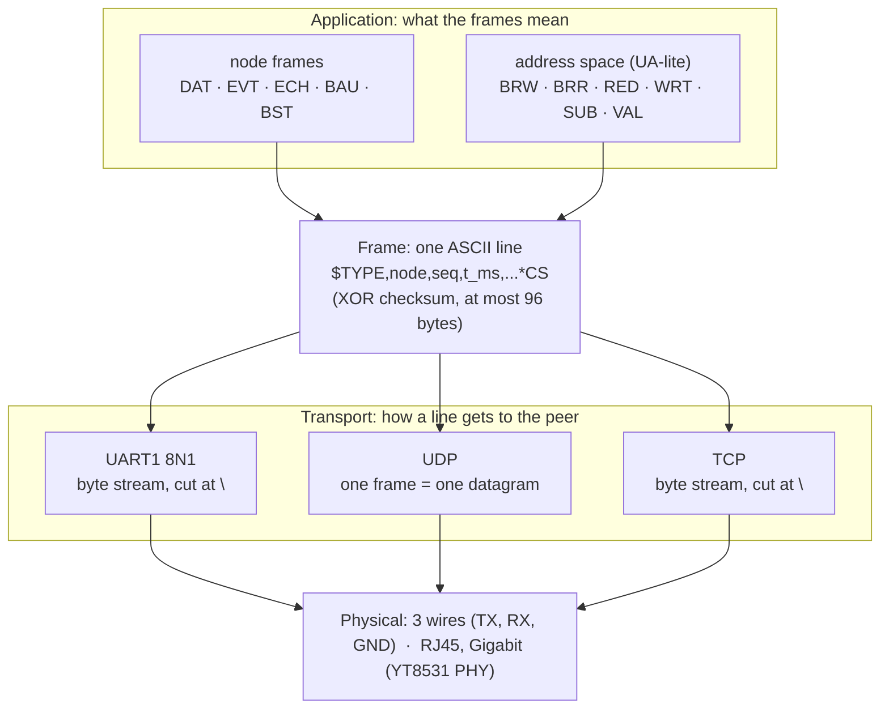
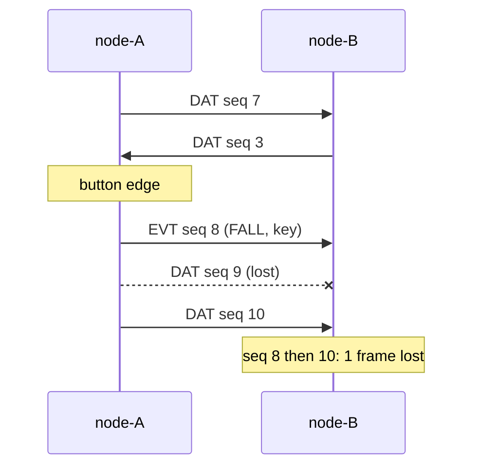
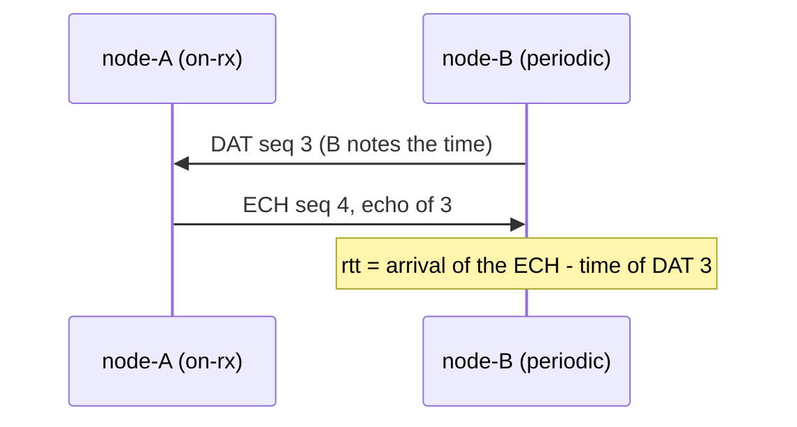
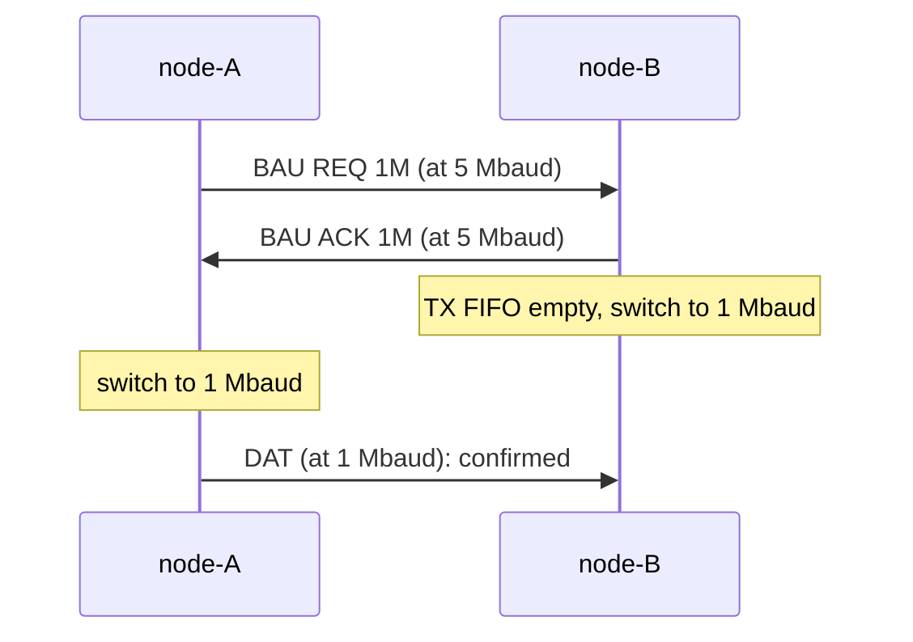
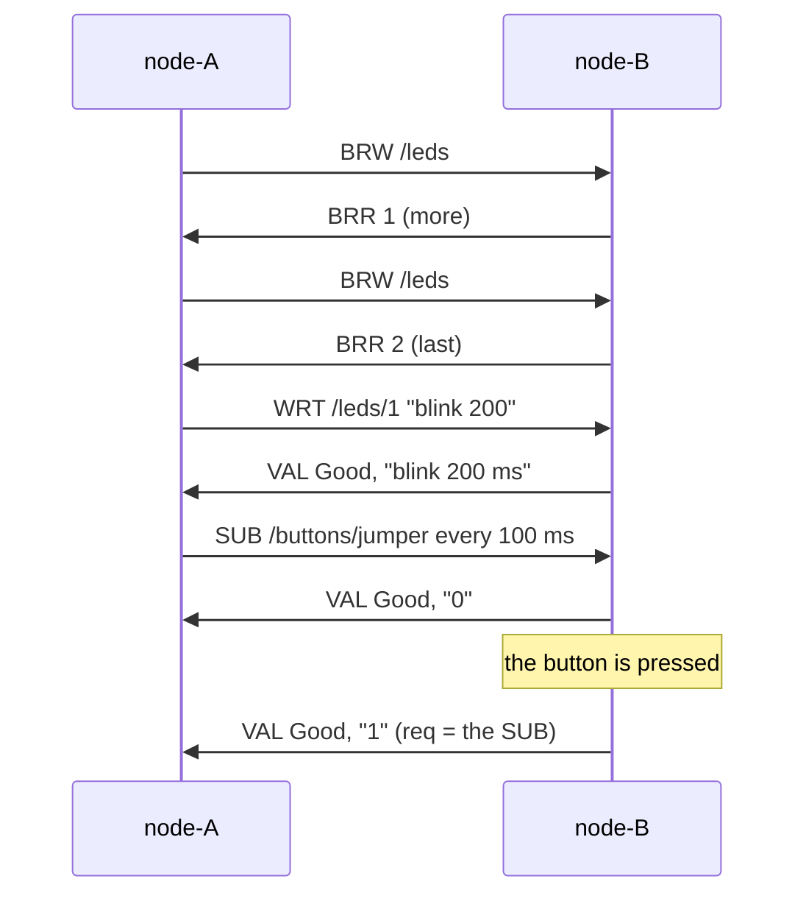

# Protocols

Two boards talk in **lines of text**. The same lines travel over three different links (the 5 Mbaud UART, UDP
datagrams, one TCP connection), and two families of frames share them: the **node frames** (`DAT`, `EVT`, `ECH`,
`BAU`, `BST`), which exercise and measure the link, and the **address space** frames (`BRW`, `BRR`, `RED`, `WRT`,
`SUB`, `VAL`), a very small OPC UA-style protocol to browse, read, write and watch what a node has.



## One frame

Every frame is one line, NMEA style:

```text
$DAT,node-A,7,12500,1,2,2500000*08
 │   │      │ │     └──────────┘ └─ checksum: XOR of every byte between $ and *, 2 uppercase hex digits
 │   │      │ └─ t_ms: the sender's uptime when it built the frame
 │   │      └─ seq: sender's sequence number
 │   └─ node: the sender's name (1-12 printable characters, no , * $)
 └─ type: 3 letters
```

- **`seq`** is one counter per node, shared by every frame it sends (except `BST`, where it holds the burst
  number). A gap in the peer's numbers is a **lost frame**; the number going back is a **restart**.
- A line is at most **96 bytes** with its `\n`; a node name of 12 characters and every number at its maximum still fit
  (a unit test checks the longest frame of each type).
- A receiver refuses a line that doesn't start with `$`, whose checksum is wrong, or whose fields don't parse, and
  counts it as `bad`. It never acts on half a frame.

The format of each frame is in the generated reference: [node frames](reference/protocol.md),
[address space](reference/space.md) (and [for Ethernet](reference/eth-protocol.md)).

## The links

| | UART | UDP | TCP |
|---|---|---|---|
| app | UART app | Ethernet app, `net.transport = "udp"` | Ethernet app, `net.transport = "tcp"` |
| a frame is | a line in a byte stream | **one datagram** (the line, `\n` included) | a line in a byte stream |
| cut into lines by | `LineBuffer`, at each `\n` | nothing: the datagram is the frame | `LineBuffer`, at each `\n` |
| lost frames | possible (noise): bad checksum, or a gap in `seq` | possible: a gap in `seq` | none; a broken connection reconnects |
| errors seen | framing, glitch, FIFO overflow, parity | none at this level | connection lost / established |
| timing of a received frame | the UART interrupt notes when each `\n` was on the wire | the network task stamps it when it leaves the socket | same |
| who talks first | both, periodically | both, periodically | the client connects, then both |
| addresses | none (point to point) | `net.address`, `net.peer`, `net.port` | same, plus `net.tcp_role` |

The UART link also has a **speed change** handshake (`BAU`); an Ethernet node ignores `BAU` frames.

## Node frames

These exist to show the link working and to measure it. Examples are the test vectors of the code.

| Frame | Sent | Carries |
|---|---|---|
| `DAT` | every `data_period_ms` (`tx_mode periodic`) | button state, number of `EVT` sent, the sender's own period (the receiver uses it for its link timeout) |
| `EVT` | on each debounced button edge | `RISE` or `FALL`, and a 64-bit random key from the TRNG |
| `ECH` | for each frame received, in `tx_mode on-rx` | the `seq` it answers: its original sender gets the round-trip time |
| `BAU` | by `baud`, UART only | the requested speed, `REQ` or `ACK` |
| `BST` | by `burst` | position in the burst, and a filler derived from it (checked on top of the checksum) |

```text
$DAT,node-A,7,12500,1,2,2500000*08
$EVT,node-A,42,123456,FALL,0123456789ABCDEF*07
$ECH,node-B,4,13100,8*1E
$BAU,node-A,8,13000,1000000,REQ*6B
$BST,node-A,2,14000,0,1000,9E3779B97F4A7C15*66
```

### Periodic data, events, loss



### Round-trip time (`tx on-rx`)

The node in `on-rx` mode stops sending `DAT` and answers every frame of the peer with an `ECH` carrying that frame's
`seq`. The peer remembers when it sent its last 16 frames and shows the difference.



### Speed change (UART only)



If no valid frame arrives at the new speed within a few periods, each node goes back to the boot speed on its own:
both know it, so they meet again there.

### Bursts

`BST` frames are scheduled at a fixed rate (frame *i* is due at *start + i / rate*, so a late loop catches up without
drifting) or back to back. The receiver counts them instead of printing them, and prints one summary: received, lost,
corrupted, throughput, and the share of the link.

## The address space (UA-lite)

The node frames are about the link. The address space is about **the node**: it describes its LEDs, buttons,
statistics and settings as a tree of named nodes, and its peer can **browse** it, **read** and **write** values, and
**subscribe** to changes. It is deliberately a very small cousin of [OPC UA](https://opcfoundation.org/about/opc-technologies/opc-ua/):

| OPC UA | UA-lite |
|---|---|
| address space of nodes (Objects, Variables), each with a NodeId | a fixed tree, NodeIds are numbers, nodes have a path: `/buttons/jumper` |
| node classes, data types, access levels | `Object` or `Variable`; `bool`, `u32`, `text`; read or read-write |
| Browse service | `BRW` / `BRR`, one child per frame |
| Read, Write services | `RED`, `WRT`, answered by `VAL` |
| subscriptions and monitored items (sampling interval, report on change) | `SUB`, then a `VAL` whenever the value changed |
| StatusCode (`Good`, `Bad...`) | the same idea: `Good` = 0, a few `Bad...` codes |
| sessions, security, namespaces, a type system, binary encoding, method calls | **left out** |

```text
/                       Object
├── node                Object      name (text)        uptime (u32 ms)
├── leds                Object      1, 2 (text, read-write): off, on, blink 200, peer, link, rx, tx...
├── buttons             Object      jumper, boot (bool)
├── rgb                 Object      pattern (text, read-write)    brightness (u32 0-100, read-write)
├── stats               Object      tx, rx, lost (u32)
└── config              Object      one text variable per runtime setting, read-write
```

The whole table, with ids and what each node is, is generated from the code: [address space reference](reference/space.md).

### From the console

The commands are requests to the **peer**; its answers print as they arrive.

```text
cli › browse /leds
  12.001 TX ▶ UA   browse /leds
    /leds/1                      variable text read-write  (id 5)
    /leds/2                      variable text read-write  (id 6)
cli › read /buttons/jumper
    /buttons/jumper              = 0
cli › write /leds/1 blink 200
    /leds/1                      = blink 200 ms
cli › write /leds/1 disco
    /leds/1                      ✗ BadTypeMismatch (still blink 200 ms)
cli › watch /buttons/jumper
    /buttons/jumper              = 0
    /buttons/jumper              = 1          <- node-B's button was pressed
cli › unwatch
```

On the other board, a write or a subscription is always shown (`node-A writes /leds/1 = blink 200`); browsing and reading
only from `verbose frames`.

### On the wire

This is the output of `cargo run -p workshop-core --example space --target host-tuple`: node B's side is the real
`serve` function, fed with the lines A sends. A browses `/leds`, reads a button, writes a LED (then tries a value that
is refused), and subscribes to the button, which B reports when it changes.

```text
A> $BRW,node-A,1,1000,4,0*33
B> $BRR,node-B,1,1000,1,5,1,VTW,1*4C
A> $BRW,node-A,2,1000,4,1*31
B> $BRR,node-B,2,1000,2,6,2,VTW,0*4D
A> $RED,node-A,3,2000,8*36
B> $VAL,node-B,3,2000,3,8,0,0*22
A> $WRT,node-A,4,3000,5,blink 200*63
B> $VAL,node-B,4,3000,4,5,0,blink 200 ms*50
A> $WRT,node-A,5,4000,5,disco*67
B> $VAL,node-B,5,4000,5,5,3,blink 200 ms*54
A> $SUB,node-A,6,5000,8,100*3E
B> $VAL,node-B,6,5000,6,8,0,0*25
B> $VAL,node-B,99,5200,6,8,0,1*10
```

Reading the lines: `$BRW,node-A,1,1000,4,0` is "child 0 of node 4 (`/leds`)"; `$BRR,...,1,5,1,VTW,1` answers request 1 with child
id 5, named `1`, a **V**ariable of type **T**ext that is **W**ritable, and `more = 1`. `$VAL,node-B,5,4000,5,5,3,blink 200 ms`
answers request 5 (`req = 5`) about node 5 with status 3 (`BadTypeMismatch`), and the value that stayed. The last line
has no request of its own: it is a notification, and its `req` (6) is the `seq` of the `SUB`.



### Rules worth knowing

- **Answers are matched by `seq`**: `req` in an answer is the `seq` of the request. Requests and answers share the node's
  `seq` counter with every other frame, so the loss detection of the link covers them too.
- **A write goes through the same checks as the CLI's `set`** (and as a preset): the value is parsed and validated, and
  the answer carries the value now in force, so a refused write is visible. `/config/<key>` is every runtime setting.
- **A subscription is sampling plus report on change**: the node reads the variable every `interval_ms` and sends it only
  if it differs from the last value it reported. Up to 4 variables at once; `unwatch` (a `SUB` with interval 0, or with
  node 65535 for all) stops them.
- **Limits**: a value is at most 24 characters without `,` `*` `$`; one node per `BRR` frame, so browsing a branch takes
  one round trip per child.
- **There is no security.** The checksum detects corruption, not forgery: anyone who can send a line to the link can
  write a LED or a setting. On Ethernet that is anyone on the subnet; keep the boards on their own cable or network.

## Extending

- **A new node** (say a temperature): add it to `NODES` in `firmware/shared/core/src/space.rs`, give it an id and a
  `doc`, and read it in `NodeSpace::read` (and `write`, if it is writable). A test checks that every node has a path that
  finds it back, that every variable can be read and that its value fits a frame; the reference page lists it by itself.
- **A new frame in the family**: add a `Body` variant, its tag in `TAGS`, its `encode` and `parse` arms, and what
  `serve` does with it. Frames are plain data, so the tests run on your computer, including a two-node exchange.
- **A new family** with its own tags: do what `space.rs` does. Check the envelope with `protocol::verify`, route by tag
  (`space::is_space`), and call `seq::check` for every frame so the loss detection stays whole.
- **A new link**: a frame is just a line, so a transport only has to deliver lines and say when each one arrived (see
  `firmware/ethernet/src/link.rs`: two queues and a task).
