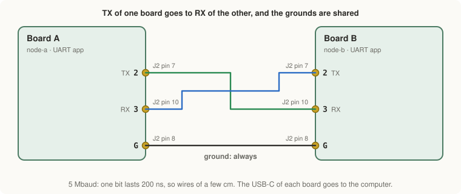
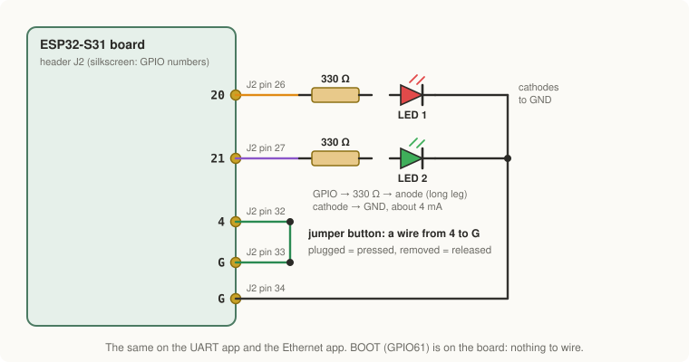
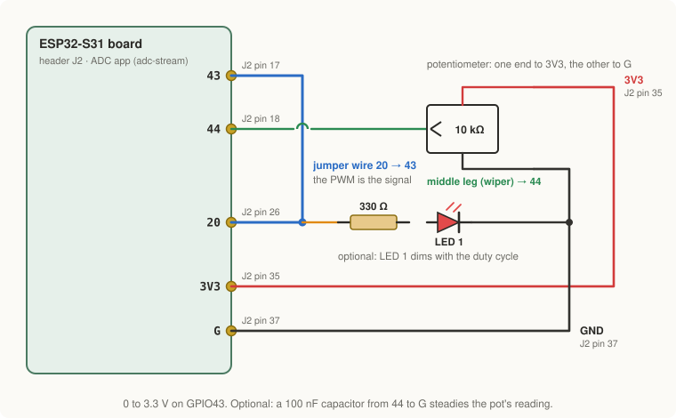

# Wiring

All signals are on header **J2**. Its silkscreen shows **GPIO numbers**, not pin
numbers: `2` is GPIO2 (J2 pin 7), `3` is GPIO3 (J2 pin 10).

There are three firmwares and each one needs its own few wires:

| App | What to wire | Where |
|---|---|---|
| **UART** (two boards) | TX/RX/GND between the boards, the jumper button, two LEDs | [UART link](#uart-link-between-the-boards), [button](#jumper-button), [LEDs](#breadboard-leds) |
| **Ethernet** (two boards) | one RJ45 cable, the same button and LEDs | [Ethernet link](#ethernet-link-between-the-boards) |
| **ADC** (one board) | the PWM pin to the analog input, a potentiometer | [ADC breadboard](#adc-app-pwm-jumper-and-potentiometer) |

### Every wire on header J2

| Signal | Label | J2 pin | Used by |
|---|---|---|---|
| UART TX | `2` | 7 | UART app (to the other board's `3`) |
| UART RX | `3` | 10 | UART app (to the other board's `2`) |
| Jumper button | `4` | 32 | UART and Ethernet apps (to `G`, pin 33) |
| LED 1 / PWM output | `20` (`D0`) | 26 | LED 1 on the node apps, the PWM generator on the ADC app |
| LED 2 | `21` (`D1`) | 27 | UART and Ethernet apps |
| ADC signal input | `43` | 17 | ADC app |
| Potentiometer wiper | `44` | 18 | ADC app |
| 3V3 | `3V3` | 35, 36 | pot end |
| GND | `G` | 8, 33, 34, 37, 38 (and 1, 2) | grounds, LED cathodes, pot end |

The numbers come from the dev kit's pinout; the silkscreen only prints the labels, so go by the label.

```text
     Board A  (node-a)                  Board B  (node-b)
  ┌────────────────────────┐        ┌────────────────────────┐
  │ GPIO2  TX ─────────────┼───────▶│ GPIO3  RX              │
  │ GPIO3  RX ◀────────────┼────────│ GPIO2  TX              │
  │ GND ───────────────────┼────────│ GND                    │
  │ GPIO4 button           │        │ GPIO4 button           │
  │ GPIO20/21 LEDs         │        │ GPIO20/21 LEDs         │
  └───────────┬────────────┘        └───────────┬────────────┘
              │ USB Serial/JTAG                 │ USB Serial/JTAG
              └────────── your computer ────────┘
                 (flash, console + CLI, probe-rs)
```

## UART link between the boards

TX of one board goes to RX of the other, and the grounds are shared:



| Board A | | Board B |
|---|---|---|
| `2` GPIO2 (TX) | → | `3` GPIO3 (RX) |
| `3` GPIO3 (RX) | ← | `2` GPIO2 (TX) |
| `G` GND | — | `G` GND |

!!! warning "5 Mbaud needs short wires"
    One bit lasts 200 ns. Keep the jumper wires short (a few cm), and always
    connect the grounds. `framing error` or `glitch on RX line` messages in the
    console point at the wiring.

## Ethernet link between the boards

For the Ethernet app, plug a cable from the **RJ45** port of one board to the RJ45 port of the other. There is nothing
to wire on header J2:

```text
   Board A  192.168.77.11                    Board B  192.168.77.12
  ┌──────────────┐        cat5e (straight)  ┌──────────────┐
  │ RJ45 ════════╪══════════════════════════╪════════ RJ45 │      no switch, no DHCP
  └──────────────┘                          └──────────────┘
```

- A straight cable is enough: the PHYs detect the cable type (Auto-MDIX). A cat5e or better cable, with all four
  pairs, is needed for 1 Gbit/s; a poorer one links at 100 Mbit/s.
- The addresses are fixed in the [presets](presets.md) of each node. A computer on the same cable (or a switch)
  needs an address in `192.168.77.0/24` to talk to a board.
- The on-board PHY (Motorcomm YT8531, RGMII) is wired to **GPIO5-19**: MDC 5, MDIO 6, reset 7, data and clocks
  8-19. The configuration check refuses those pins for anything else
  ([Ethernet pins](reference/eth-pins.md)); the usual pins of this page (button 4, LEDs 20 and 21) don't clash.
- USB-C (USB Serial/JTAG) stays your console and flashing port, as for the UART app.

## Jumper button

GPIO4 has its internal pull-up enabled. A wire from `4` (J2 pin 32) to `G`
(J2 pin 33, right next to it):

- plugged: line low, **pressed**, `FALL` event;
- removed: line high, **released**, `RISE` event.

The board's **BOOT** button (GPIO61, nothing to wire) works the same way: press
it for a `FALL`, release it for a `RISE`. Each `EVT` line in the console says which
button sent it (`jumper` or `BOOT`), and `DAT` frames report "pressed" while
either one is held. BOOT keeps its usual role at power-up: held during a reset, it
starts the ROM's download mode instead of the firmware.

## Breadboard LEDs

Each LED: GPIO → 330 Ω resistor → LED anode (long leg), cathode → GND. That's
about 4 mA for a red LED at 3.3 V.



| LED | GPIO | J2 label |
|---|---|---|
| LED 1 | 20 | `D0` |
| LED 2 | 21 | `D1` |

What each LED shows is set by `led1` / `led2` (see the
[settings](reference/config.md)): peer's button, link state, RX/TX activity...

## ADC app: PWM jumper and potentiometer

The ADC app ([guide](adc-stream.md)) runs on **one** board. It needs a signal to measure, and the board can make
one: its PWM generator is on GPIO20 (`D0`), its ADC input on GPIO43 (`43`). A **potentiometer** on GPIO44 turns the
generator into something you can play with: the knob sets the PWM's frequency or its duty cycle, and the spectrum
on the page follows.



| Wire | From | To |
|---|---|---|
| signal | `20` (`D0`, J2 pin 26) | `43` (J2 pin 17): the generator is what the ADC measures |
| pot wiper (middle leg) | pot | `44` (J2 pin 18) |
| pot end | pot | `3V3` (J2 pin 35 or 36) |
| pot end | pot | `G` (J2 pin 37 or 38) |

- Any linear potentiometer from 1 kΩ to 50 kΩ does; **10 kΩ** is the sweet spot. A bigger one is a weaker source
  for the ADC and picks up the signal of its neighbour pin; a smaller one just wastes current.
- If the reading flickers, add a **100 nF** ceramic capacitor from `44` to `G`: it takes the noise out before the
  ADC sees it. The firmware already averages about 20 ms of readings, so it is rarely needed.
- LED 1 on `D0` is still possible (same resistor as above): it dims with the duty cycle of the PWM. Don't add
  anything else to `43`: it is the measured signal.
- 3V3 is the only supply of the knob. Never wire the pot to 5 V: the ADC input stops at 3.3 V.

Choose what the knob does, from the **Potentiometer** card of the page or with the `pot` command (in the page's
terminal, or `dev.py monitor`):

```text
pot freq min=100 max=5000     knob sets the frequency: 100 Hz at the GND end, 5 kHz at the 3V3 end (logarithmic)
pot duty min=0 max=100        knob sets the duty cycle (linear); the frequency stays what `pwm` set
pot off                       GPIO44 is not read again, the ADC takes the signal alone at the full rate
pot freq every=8              the pot takes one ADC conversion in 8 (2 to 16, default 16)
pot                           tells the mode, the range, how often it is read and the raw conversions of GPIO44
```

A low end above the high end (`pot duty min=100 max=0`, or the **Reverse** button) turns the knob the other way:
there is no need to swap the wires. The knob owns exactly one number of the generator; the other one stays what
`pwm freq=… duty=…` last set, and its controls on the page grey out while the knob owns the first.

### Checking it

1. `pot freq min=100 max=5000`, then turn the knob from end to end: the **Knob** bar moves, the *reading* goes
   between about 2190 (GND end) and 0 (3V3 end), and the spectrum's peak slides from 100 Hz to 5 kHz.
2. `pot duty min=10 max=90`: the waveform's high part grows and shrinks, and the harmonics change.
3. The reading never moves: the wiper is not on `44` (see the wire table above) or an end is missing. It sits at
   the same end whatever you do: the other end of the pot is not wired.

!!! note "The reading counts down"
    On the ESP32-S31 the ADC is differential and the even channels read the other way round: **GPIO44 gives 2198
    at 0 V and 0 at 3.3 V**, where the signal pin GPIO43 gives 2198 at 0 V and 4393 at 3.3 V. The firmware knows
    ([`pot.rs`](https://github.com/Lpwlk/esp32-rust-workshop/blob/main/firmware/adc-stream/src/pot.rs)): the knob's
    position is 0 % at the GND end whichever way the code runs. You only see it in the *reading* number.

While the knob is on, the ADC reads it **once every `every` conversions** (16 by default) and gives all the other
ones to the signal. A knob needs a hundred readings a second, not thousands, so by default the signal keeps **15/16**
of the ADC's 83.3 kS/s: **78.1 kS/s** at most, the knob read at 5.2 kHz. `every=2` makes the knob and the signal
alternate (41.6 kS/s of signal); with `pot off` the full rate is back.

## Pins to avoid

Some GPIOs are used by the module (flash, USB) or don't exist. The configuration
check refuses them; see the [pin reference](reference/pins.md) (and the
[Ethernet one](reference/eth-pins.md), which adds GPIO5-19).
